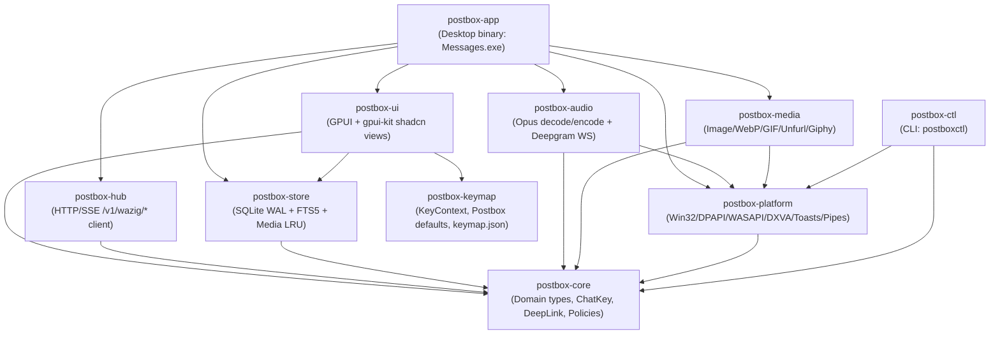

# `postbox-rs` — Minimal Rust Rewrite Plan (GPUI + shadcn + Intel Arc)

## 1. Executive Summary & Locked Decisions

`postbox-rs` is a clean-slate Rust rewrite of `Postbox` (currently ~64k LOC of Zig using CPU-bound Win32 GDI/GDI+ + DirectWrite) targeting **low CPU/RAM footprint**, **sub-frame keyboard latency**, **shadcn visual craft**, and **Intel Arc GPU acceleration** — with zero Electron, WebView, or Tauri runtime.

| Area | Locked Decision |
| --- | --- |
| **UI & GPU Engine** | **Zed GPUI + `gpui-kit` (`0.11.0`)** — hardware-accelerated DirectX rendering on Windows (Intel Arc), Tailwind-like flexbox/grid (`taffy`), native Rust **shadcn/ui** components (`gpui-component` + `gpui-base`), Lucide icons, AccessKit, and headless UI testing. `default-features = false` (no `tree-sitter`, `syntect`, or `gpui-shell` bloat). |
| **Repository & Migration** | Clean-slate public repo **`valentinyeo/postbox-rs`**. Preserves the existing **Triage Hub `/v1/wazig/*` HTTP + SSE contract** and **DPAPI `DEEPGRAM_API_KEY` seeding**, while redesigning local storage, config, and Rust-native tests without legacy `wazig` baggage. |
| **Visual Design & Invariants** | Preserves Postbox's product invariants: **no toolbar** (all commands in `Ctrl+K`), **IBM Plex Sans + Mono** with saved 60–160% scaling, **auto-download all media on open**, **in-app voice playback + cached transcripts**, and **atomic self-update**. Styled with **shadcn's crisp Zinc/AMOLED dark aesthetic** (1px borders, subtle rings, clean `cmdk` palette, compact density) plus optional Light/Dark/AMOLED themes in `Ctrl+K`. |
| **Keyboard Architecture** | Preserves Postbox's exact muscle-memory keymap (`shortcuts.zig`) as built-in defaults on GPUI's declarative `KeyContext`/`Action` system, with hold-`Ctrl` `1..9` shortcut badges, chords (`G then I`, `Alt+G, Alt+G`), unified fuzzy `Ctrl+K`, and optional `keymap.json` overrides. |
| **Local Persistence & Search** | **Embedded SQLite (`rusqlite`, WAL + FTS5)** for chats, messages, drafts, transcripts, and ACID durable outbox + content-addressed disk media cache (14-day LRU eviction) + bounded GPU texture LRU. |
| **Feature Scope** | **100% full parity** across all 7 subsystems: Core Hub messaging (WhatsApp/Slack/Telegram/Signal), Voice notes (Opus 1x/1.5x/2x + transcripts + recording), Deepgram live dictation (`Ctrl+D`), Inline media/WebP/GIFs/custom emoji/lightbox, Video thumbnails + inline player (`F11`), Link unfurls + Giphy picker, Windows OS integration (Toasts, `postbox://`, atomic updater), and `postboxctl` named-pipe CLI. |
| **Platform & CI** | **Windows-first with a thin `postbox-platform` trait boundary**: native Windows APIs (Intel Arc DX11/DXVA Media Foundation, WASAPI, DPAPI, Toasts, Named Pipes, Registry) sit behind traits so core crates and tests compile and pass fast on Linux CI while keeping Linux/macOS possible later. |

---

## 2. Footprint, Latency & Intel Arc GPU Optimization Strategy

### Concrete Performance Budgets (Real-Size Inbox: 320 chats, 6,704 messages, 638 images, 319 voice notes)

| Metric | Zig Postbox (GDI/GDI+) | `postbox-rs` Target | Enforcement Mechanism |
| --- | --- | --- | --- |
| **Cold start to painted inbox** | ~250–400 ms (JSON parse) | **`< 120 ms`** | SQLite WAL indexed top-50 query (`< 15 ms`), deferred hub sync after first GPU frame |
| **Idle RAM (working set)** | ~40–60 MB | **`< 65 MB`** | Windowed SQLite queries, bounded message window, compact structs, no WebView/JS VM |
| **Active RAM (real-size inbox)** | ~90–140 MB | **`< 110 MB`** | Virtualized chat & message lists, bounded image decode cache (`<= 48 MB` RAM) |
| **GPU VRAM budget (Intel Arc)** | N/A (CPU BitBlt) | **`<= 16 MB`** | Explicit LRU eviction of decoded image/avatar/GIF GPU textures when off-screen (64 MB in M3, tightened in M5.5) |
| **Idle CPU & GPU utilization** | ~0–1% | **`0.0%` CPU / `0.0%` GPU** | Event-driven GPUI rendering (zero polling loops; GIF/dictation timers tick only while visible/active) |
| **Keystroke-to-photon latency** | ~16–35 ms (CPU GDI+) | **`< 8 ms` (1 frame @ 120/144Hz)** | GPUI instanced DirectX quad/glyph batching on Intel Arc; zero blocking I/O on UI thread |
| **Instant search (`/` or `Ctrl+K`)** | O(N) scan over loaded chats | **`< 2 ms`** | SQLite FTS5 prefix + trigram index over chats & messages + nucleo fuzzy ranking |
| **Release binary size** | ~2–3 MB | **`< 28 MB`** | `opt-level = "s"`, `lto = "fat"`, `codegen-units = 1`, `strip = true`, `panic = "abort"`, minimal `gpui-kit` features |

### Intel Arc GPU-Specific Optimizations
1. **Instanced GPU UI Batching (GPUI DirectX backend)**: Rounded message bubbles, 1px shadcn borders, subtle elevation rings, selection highlights, and DirectWrite glyphs are batched into instanced GPU draw calls directly on Intel Arc instead of CPU GDI+ paths (`smooth_shapes.zig` is completely eliminated).
2. **Hardware Video Decode via Intel Arc DXVA / Quick Sync**: Video thumbnails and inline video playback (`F11` fullscreen) use **Windows Media Foundation** (`IMFSourceReader` with `IMFDXGIDeviceManager` + `MF_SOURCE_READER_ENABLE_ADVANCED_VIDEO_PROCESSING`), offloading H.264/HEVC/AV1/VP9 decoding directly to the Intel Arc media engine with zero bundled `ffmpeg` binaries and near-0% CPU.
3. **Zero-Copy & Bounded Texture Upload**: Images (PNG/JPEG/WebP/GIF) decode off the UI thread on a bounded `rayon`/tokio blocking pool (max `min(4, cores/2)` workers), downscale to display DPI before upload, and live in a strict byte-capped LRU cache so scrolling 638 images never spikes VRAM or stutters 120Hz scrolling.
4. **Pause-When-Occluded**: Animated GIF frame ticks and dictation waveform bars automatically suspend when the window is minimized, occluded, or scrolled out of the viewport.

---

## 3. Cargo Workspace Architecture



### Crate Responsibilities
- **`crates/postbox-core`**: Pure, zero-OS-dependency domain models and invariants — provider-qualified `ChatKey(Provider, account, id)` (never comparing bare JIDs), `Chat`, `Message`, `Reaction`, `ViewTab`, `ThemeChoice`, `FontScale` (`60..=160`), `postbox://` deep-link parser, `DictationLanguage` (`Auto`/`English`/`German`) fail-closed policy, local WhatsApp hub-archive re-surface rules (`IGSH-902`), and `ControlCommand` IPC schema.
- **`crates/postbox-hub`**: Strict **hub-only** `/v1/wazig/*` REST + SSE client (chats, paginated messages with `before` cursor, send text/broadcast/multipart file, mark-read, archive/archive-batch, react, delete, media/avatar/workspace-icon/Slack-custom-emoji binaries, SSE `/v1/wazig/events` with `Last-Event-ID` reconnect & backoff). Enforces that zero direct WhatsApp/Slack/Telegram/Signal connectors exist in the desktop binary.
- **`crates/postbox-store`**: Embedded SQLite (`rusqlite` bundled, `journal_mode=WAL`, `synchronous=NORMAL`, `mmap_size=64MB`, `cache_size=-16000`) + FTS5 virtual table for sub-ms chat/message search, ACID durable outbox queue (`ready`/`uncertain`/`held` phases with idempotent `client_id` and retry backoff matching the existing TLA+ `send-queue` invariants), cached voice transcripts, drafts per `ChatKey`, view order persistence, and a 14-day content-addressed disk media cache.
- **`crates/postbox-keymap`**: Declarative keymap engine mirroring every shortcut from `shortcuts.zig`, `InboxSequence` (`G then I` within 900 ms) and `LatestSequence` (`Alt+G, Alt+G`) chord state machines, smart `Ctrl+A` rule (selects all chats when composer is empty), hold-`Ctrl` `1..9` badge visibility state, and JSON user override merging (`keymap.json`).
- **`crates/postbox-platform`**: Thin OS trait boundary:
  - `SecretStore`: Windows DPAPI (`CryptProtectData`/`CryptUnprotectData`), reading `HKCU\Environment\DEEPGRAM_API_KEY` on startup and syncing to encrypted storage.
  - `AudioBackend`: Windows WASAPI loopback-safe capture (default communications mic for `Ctrl+D` dictation & `Ctrl+Shift+M` voice notes) and low-latency WASAPI render (1x/1.5x/2x time-stretched playback).
  - `VideoBackend`: Windows Media Foundation + Intel Arc DXVA (`IMFDXGIDeviceManager`) thumbnail extraction and inline frame streaming.
  - `OsIntegration`: Windows Toast XML notifications, `HKCU\Software\Classes\postbox` URL protocol registration, single-instance mutex + `\\.\pipe\postbox-link-<user>` forwarder, `\\.\pipe\postbox-control-<user>` control server, atomic GitHub Release self-updater (stage -> verify SHA-256 -> `MoveFileExW` atomic swap -> relaunch maximized on last monitor), and crash/exit record persistence.
  - Portable in-memory mock implementations under `#[cfg(not(windows))]` and `#[cfg(test)]` for fast headless CI testing.
- **`crates/postbox-media`**: Off-UI-thread media pipeline — auto-download queue triggered on chat open (voice notes, images, videos, stickers, documents), PNG/JPEG/WebP/animated GIF decode, Slack custom emoji resolution, Giphy catalogue search, and safe link unfurling.
- **`crates/postbox-audio`**: Ogg Opus decoding/encoding (`opus` + `ogg`), variable-speed playback (`1.0x`, `1.5x`, `2.0x`) without pitch distortion, Deepgram Nova-3 WebSocket live dictation client (anchored interim-span replacement + clean CloseStream drain without duplicate finals), and cached voice-note transcription retry queue.
- **`crates/postbox-ui`**: GPUI + `gpui-kit` shadcn UI layer:
  - **Themes**: `ShadcnZincDark` (default), `Amoled` (pure `#000000` canvas with crisp 1px `#27272A` borders), and `ShadcnLight`, all using bundled **IBM Plex Sans** (Regular/Medium/SemiBold/Bold/Italic) + **IBM Plex Mono** with live `60%–160%` font scaling (`Ctrl+-`/`Ctrl++`/`Ctrl+0`).
  - **Layout (No Toolbar)**:
    - Left sidebar: compact account/view switcher rail (`Alt+I` combined inbox + `Alt+1..9` accounts with workspace icons / provider badges) + virtualized chat list with unread dots, archive pills, and hold-`Ctrl` `1..9` kbd badges.
    - Main canvas: virtualized variable-height message timeline (sender avatars, grouped bubbles, date dividers, inline images/GIFs/videos, voice-note waveform pill with speed & inline transcript toggle, reply quote bars, Slack inline threads & broadcast toggle, reaction chips below bubbles, read ticks) + auto-growing shadcn composer (reply banner, staged pasted images, `@mention` popover, live dictation waveform pill).
    - Overlays: unified **`Ctrl+K` shadcn `cmdk` Command & Search Palette** (fuzzy-matches all commands, archived chats, and FTS5 chats/messages), `F1` shortcuts sheet, `Ctrl+R` emoji reaction picker, Giphy picker, full-window Image Lightbox, and `F11` inline Video Player.
- **`crates/postbox-app`**: Minimal executable wiring `postbox-platform` + `postbox-store` + `postbox-hub` + `postbox-ui` with Windows GUI subsystem (`#![cfg_attr(not(debug_assertions), windows_subsystem = "windows")]`), single-instance handoff, and startup timing telemetry.
- **`crates/postbox-ctl`**: Tiny zero-GUI CLI (`postboxctl`) speaking JSON lines over `\\.\pipe\postbox-control-<user>` (`status`, `theme`, `font`, `chats`, `search`, `view`, `select`, `messages`, `archive`, `unarchive`, `archive-many`).

---

## 4. SQLite (WAL + FTS5) Local Schema

```sql
PRAGMA journal_mode = WAL;
PRAGMA synchronous = NORMAL;
PRAGMA foreign_keys = ON;
PRAGMA mmap_size = 67108864;

CREATE TABLE accounts (
    provider TEXT NOT NULL,           -- whatsapp | slack | telegram | signal
    account_id TEXT NOT NULL,
    label TEXT NOT NULL,
    state TEXT NOT NULL,
    sort_order INTEGER NOT NULL,
    last_event_at TEXT,
    PRIMARY KEY (provider, account_id)
);

CREATE TABLE chats (
    provider TEXT NOT NULL,
    account_id TEXT NOT NULL,
    chat_id TEXT NOT NULL,
    title TEXT NOT NULL,
    is_group INTEGER NOT NULL DEFAULT 0,
    archived_local INTEGER NOT NULL DEFAULT 0,
    archived_remote INTEGER NOT NULL DEFAULT 0,
    pinned INTEGER NOT NULL DEFAULT 0,
    unread_count INTEGER NOT NULL DEFAULT 0,
    last_msg_ts TEXT NOT NULL DEFAULT '',
    last_msg_preview TEXT NOT NULL DEFAULT '',
    avatar_hash TEXT,
    updated_at INTEGER NOT NULL,
    PRIMARY KEY (provider, account_id, chat_id)
);

CREATE TABLE messages (
    provider TEXT NOT NULL,
    account_id TEXT NOT NULL,
    chat_id TEXT NOT NULL,
    msg_id TEXT NOT NULL,
    sender_id TEXT NOT NULL,
    sender_name TEXT NOT NULL,
    from_me INTEGER NOT NULL DEFAULT 0,
    ts TEXT NOT NULL,
    body TEXT NOT NULL DEFAULT '',
    reply_to_id TEXT,
    reply_broadcast INTEGER NOT NULL DEFAULT 0,
    media_type TEXT,                  -- image | gif | video | voice | sticker | document
    mime_type TEXT,
    filename TEXT,
    reactions_json TEXT NOT NULL DEFAULT '[]',
    read_status TEXT NOT NULL DEFAULT 'none',
    deleted INTEGER NOT NULL DEFAULT 0,
    PRIMARY KEY (provider, account_id, chat_id, msg_id)
);

CREATE INDEX idx_messages_timeline
    ON messages (provider, account_id, chat_id, ts DESC, msg_id DESC);

CREATE VIRTUAL TABLE messages_fts USING fts5(
    chat_title,
    sender_name,
    body,
    content='',
    tokenize='unicode61 remove_diacritics 2'
);

CREATE TABLE outbox (
    client_id TEXT PRIMARY KEY,
    provider TEXT NOT NULL,
    account_id TEXT NOT NULL,
    chat_id TEXT NOT NULL,
    kind TEXT NOT NULL,               -- text | file | voice | react | delete
    phase TEXT NOT NULL,              -- ready | uncertain | held
    attempt_serial INTEGER NOT NULL DEFAULT 0,
    text_body TEXT NOT NULL DEFAULT '',
    reply_to_id TEXT,
    reply_broadcast INTEGER NOT NULL DEFAULT 0,
    staged_file_path TEXT,
    file_sha256 BLOB,
    failure_reason TEXT,
    not_before_ms INTEGER NOT NULL DEFAULT 0,
    created_at_ms INTEGER NOT NULL
);

CREATE TABLE transcripts (
    media_sha256 TEXT PRIMARY KEY,
    language TEXT NOT NULL,
    text TEXT NOT NULL,
    created_at INTEGER NOT NULL
);

CREATE TABLE drafts (
    provider TEXT NOT NULL,
    account_id TEXT NOT NULL,
    chat_id TEXT NOT NULL,
    text_body TEXT NOT NULL DEFAULT '',
    reply_to_id TEXT,
    staged_image_path TEXT,
    updated_at INTEGER NOT NULL,
    PRIMARY KEY (provider, account_id, chat_id)
);

CREATE TABLE media_cache (
    cache_key TEXT PRIMARY KEY,
    sha256 TEXT NOT NULL,
    rel_path TEXT NOT NULL,
    mime_type TEXT NOT NULL,
    byte_size INTEGER NOT NULL,
    last_accessed_at INTEGER NOT NULL
);
```

---

## 5. Phased Implementation Roadmap (8 Shippable Milestones)

### Milestone 0 — Workspace Scaffold & CI Foundation *(Done in this session)*
- Create `valentinyeo/postbox-rs` Cargo workspace (`postbox-core`, `postbox-hub`, `postbox-store`, `postbox-keymap`, `postbox-platform`, `postbox-ui`, `postbox-app`, `postbox-ctl`).
- Port IBM Plex Sans/Mono font assets + OFL license and Postbox icon.
- Implement core domain types (`ChatKey`, `DeepLink`, `DictationPolicy`, `ArchiveRules`), Hub `/v1/wazig/*` request builders, SQLite WAL + FTS5 schema & migrations, Postbox default keymap + `keymap.json` override merger, and `postbox-platform` traits.
- Set up GitHub Actions CI: fast Linux `cargo test --workspace` + Windows `x86_64-pc-windows-msvc` release/check pipeline.

### Milestone 1 — GPUI + shadcn Shell, Themes & Keyboard Engine
- Boot real `gpui-kit` (`0.11.0`) window with **no toolbar**, bundled IBM Plex Sans/Mono, live 60–160% scaling, and shadcn `ZincDark` / `Amoled` / `Light` themes.
- Wire all GPUI `KeyContext` scopes (`Workspace`, `ChatList`, `MessageList`, `Composer`, `ComposerEmpty`, `Palette`) + hold-`Ctrl` `1..9` badges + `F1` shortcut overlay.
- Build unified **`Ctrl+K` shadcn `cmdk` palette** (commands + FTS5 instant search) and virtualized sidebar + message timeline driven by SQLite.
- **Gate**: Headless `gpui-kit` UI tests verify focus, keybindings, palette search, and theme/font scaling; cold start `< 120 ms` on Windows + Intel Arc.

### Milestone 2 — Live Hub Sync (`/v1/wazig/*` + SSE) & ACID Durable Outbox
- Implement `postbox-hub` HTTP/2 + SSE client with `Last-Event-ID` resume, exponential backoff, and cursor pagination (`before` older-history loading).
- Implement ACID outbox worker (`ready` -> in-flight -> `acknowledged`/`retryable`/`held`) preserving Postbox's send-queue guarantees (never drops messages on crash, never double-sends ambiguous attempts without reconciliation, failed sends don't block other chats).
- Wire Combined Inbox (`Alt+I`/`G then I`) + per-account views (`Alt+1..9`), saved view sorting, local WhatsApp archive re-surface rules (`IGSH-902`), unread filter (`U`), pins, drafts, read ticks, bulk archive (`Ctrl+A` -> `Ctrl+E`), and replies/Slack threads + broadcast toggle.
- **Gate**: Integration tests against a Rust loopback mock Hub verify real-size inbox (320 chats / 6,704 msgs), SSE live updates, crash-recovery outbox replay, and view switching.

### Milestone 3 — Media Auto-Download, Inline Images/WebP/GIFs & Reactions
- Auto-download worker triggered immediately on chat open (14-day content-addressed LRU disk cache + bounded `<= 64 MB` GPU texture LRU).
- Off-UI-thread decoding for PNG, JPEG, WebP, animated GIFs (paused when off-screen/occluded), avatars, workspace icons, and Slack custom emoji.
- Paste-to-attach (`Ctrl+V`), full-window Image Lightbox (`Esc`/`Space`/`Enter`), `Ctrl+R` emoji reaction picker (with reaction chips below bubbles), `@mention` autocomplete, link unfurl preview cards, and Giphy picker.
- **Gate**: Real-size scrolling benchmark on Intel Arc maintains 120 FPS with active RAM `< 110 MB` and VRAM `<= 64 MB`.

### Milestone 4 — Voice Notes (Opus Playback/Recording) & Cached Transcripts
- In-app Ogg Opus decoder + WASAPI render backend supporting `1.0x`, `1.5x`, `2.0x` playback (`Ctrl+P` play/pause, waveform scrubber).
- Voice-note transcription worker with SQLite `transcripts` cache (never re-requests a cached SHA-256), `Ctrl+T` inline transcript toggle, copy transcript / copy all transcripts, and retry state machine.
- `Ctrl+Shift+M` voice-note recording via WASAPI capture -> Opus Ogg encoding -> durable outbox upload (`ptt: true`).
- **Gate**: Round-trip Opus encode/decode + transcript cache tests pass without audio hardware via mock `AudioBackend`.

### Milestone 5 — Deepgram Live Streaming Dictation (`Ctrl+D`)
- Windows DPAPI secret seeding from `HKCU\Environment\DEEPGRAM_API_KEY` (trim, encrypt, refresh on change, safe to remove env var afterward).
- WASAPI microphone capture streaming PCM over WebSocket to Deepgram Nova-3 (`/v1/listen?model=nova-3&smart_format=true&...`) with Auto (EN/DE fail-closed), English, and German modes.
- Anchored interim-span replacement inside the GPUI composer (text before/after cursor stays intact; CloseStream drains final once without duplication) + live waveform mic pill.
- **Gate**: Loopback WebSocket dictation tests verify fragmented interims, replayed finals, cursor preservation, and all 3 language modes.

### Milestone 5.5 — RAM Diet Pass (idle `~40-55 MB`, active `~65-85 MB`)
- SQLite diet: `PRAGMA mmap_size = 0` (no unreclaimable mapped pages), `PRAGMA cache_size = -2000` (2 MiB per connection), and `PRAGMA shrink_memory` after bulk syncs and on every idle/minimize tick.
- Media diet: GPU texture LRU cap `64 -> 16 MiB`, decoded bitmap budget `24 -> 12 MiB`, off-UI-thread decode concurrency hard-capped at 2 workers, and `pool_max_idle_per_host(2)` on every `reqwest` client.
- Active-chat-only RAM: leaving a chat evicts its inline media and GIF frames, and a chat switch reloads only that chat's timeline from SQLite (no multi-chat message map).
- Windows working-set trim (`SetProcessWorkingSetSizeEx`) plus `GetProcessMemoryInfo` telemetry (`working_set_kb`, `private_usage_kb`) on minimize/extended idle, wired into `TelemetryCounters`.
- Emoji and Slack shortcode tables stay strictly lazy (built on first emoji use, never at startup) and borrow CLDR names that need no rewriting.
- **Gate**: `cargo fmt --all --check`, `cargo clippy --workspace --all-targets -- -D warnings`, `cargo test --workspace`, plus unit tests for every measured budget above.

### Milestone 6 — Hardware-Accelerated Video (Intel Arc DXVA / Media Foundation)
- Windows Media Foundation `IMFSourceReader` + `IMFDXGIDeviceManager` hardware decode on Intel Arc for instant video thumbnail generation (cached to disk) and inline video playback (double-click to play, `F11` fullscreen, audio sync via WASAPI).
- **Shipped**: `VideoBackend` / `VideoPlaybackSession` traits with a deterministic `MockVideoBackend`; Media Foundation + DXVA backend in `postbox-platform/src/win/video.rs` (lazy `MFStartup` and DLL loading, D3D11 `VIDEO_SUPPORT` + `BGRA_SUPPORT` device manager, software fallback, `.f4v`/`.f4p` `.mp4` alias); PNG video thumbnails cached beside the content-addressed media cache, keyed by video SHA-256 and evicted by the same 14-day LRU; video bubbles with play badge, duration chip and fallback card; inline player with `F11` fullscreen, `Esc` (exits fullscreen first), `Space` play/pause, scrubber, mute, `elapsed / total` clock, hardware badge; audio via `AudioBackend::open_render` with the render clock driving presentation (wall clock when silent/muted); pause-when-occluded and release on close/chat-switch.
- **Gate**: `cargo fmt --all --check`, `cargo clippy --workspace --all-targets -- -D warnings`, `cargo test --workspace`, `cargo test -p postbox-ui --features desktop-test`, plus `cargo clippy -p postbox-platform --target x86_64-pc-windows-msvc --all-targets -- -D warnings`. The `< 5%` CPU measurement still needs a physical Intel Arc machine; the decoder falls back to software when DXVA is unavailable.

### Milestone 7 — Windows OS Integration, `postboxctl` & Atomic Self-Updater
- Windows Toast XML notifications with click-to-focus chat routing.
- Per-user `postbox://` protocol registration + single-instance mutex & `\\.\pipe\postbox-link-<user>` forwarder (routing WhatsApp/Slack/Telegram/Signal links by account + chat + optional message scroll, non-modal "Chat not found" card).
- `postboxctl` CLI + `\\.\pipe\postbox-control-<user>` JSON-line control server (`status` with live FPS/RAM/paint telemetry, `theme`, `font`, `chats`, `search`, `view`, `select`, `messages`, `archive`, `unarchive`, `archive-many`).
- Atomic GitHub Releases self-updater (never leaves install without a runnable exe) + crash/exit record reporting + release installer (`.msi`/WiX or `.exe`).
- **Shipped**: automatic background update check 20s after the first frame and every 15 minutes after that (Zig cadence), background download + SHA-256 verify + extraction into `postbox.exe.staged.exe` beside the live binary, a non-modal shadcn "Postbox vX.Y.Z is ready" card with **Restart to update** and **Later**, the same flow from `Ctrl+K` ("Check for updates now" plus "Restart to install update" once staged), a local-only dismissal per version, and `stage`/`commit` split in `postbox-platform::updater` so the restart click alone does the atomic `MoveFileExW` swap. The relaunch passes `--update-relaunch --window-state "<geometry>"`, so the fresh build waits for the old process's single-instance mutex and reopens maximized on the same monitor.
- **Gate**: End-to-end Windows release verification, memory/latency benchmark report against Zig Postbox, and first tagged `v0.1.0` release.
